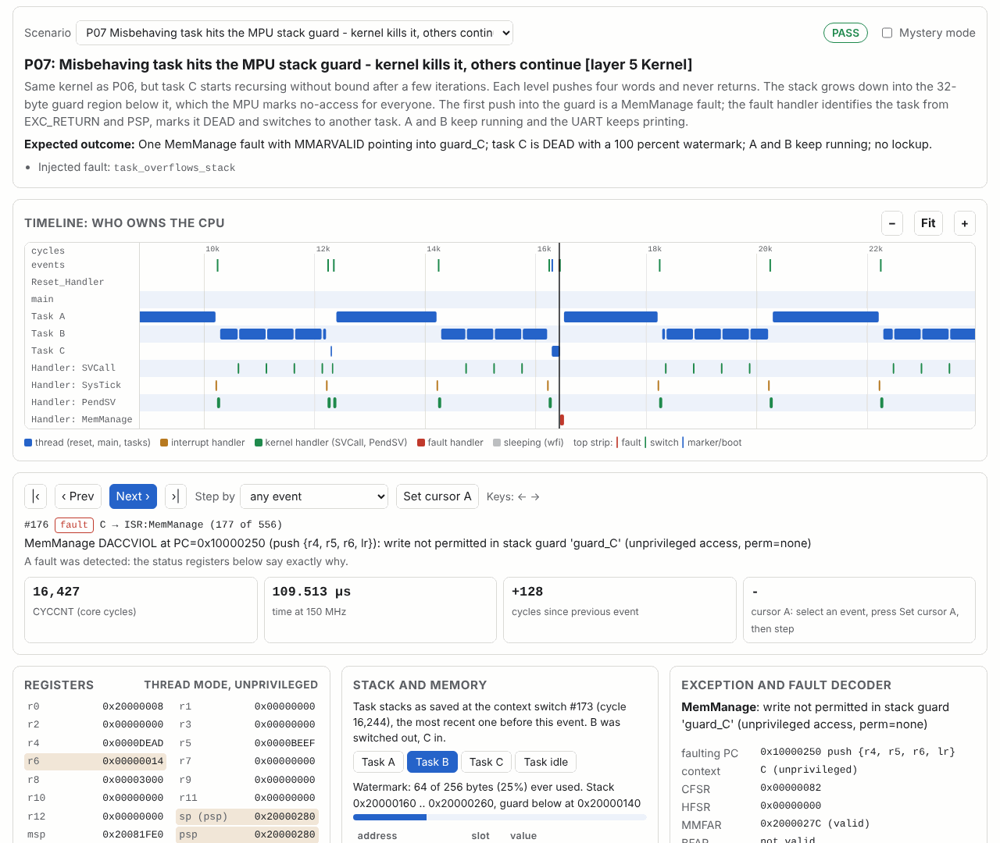
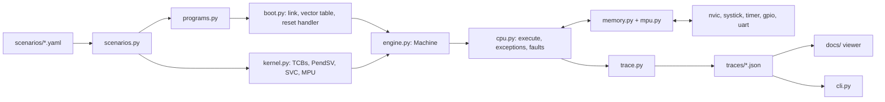

# reset-to-scheduler-sim

[](https://github.com/fakhter-uvm014/reset-to-scheduler-sim/actions/workflows/ci.yml)
[](https://fakhter-uvm014.github.io/reset-to-scheduler-sim/)

**From power-on reset to a preemptive kernel, one event at a time.** A
simulator for the *Reset to Scheduler* course project, in which students
take a Raspberry Pi Pico 2 (RP2350, Arm Cortex-M33) from the vector table
to a small multitasking kernel. Each of 18 scenarios runs one step of that
project, healthy or with a classic bug injected. The run produces a trace
in which every event explains itself: boot steps, exception frames,
EXC_RETURN values, tail-chains, context switches, system calls, decoded
fault registers and cycle counts. You can read the trace on the command line
or step through it in the browser viewer.

[](https://fakhter-uvm014.github.io/reset-to-scheduler-sim/#P07)

**Scope.** This is a behavioral model for learning and demonstration. It
implements a Thumb-2 instruction subset at the assembly level (no binary
encoding) on top of a memory map, exception model, NVIC, SysTick, timer
and MPU shaped like the RP2350's Cortex-M33. It is **not** an RP2350
emulator and does not run real firmware. Its cycle costs are approximate,
not cycle-accurate: they reproduce the shape of what you measure on the
board, not the exact numbers.

> **New here?** [HOW-TO-USE.md](HOW-TO-USE.md) walks you through install, a 10-minute validation checklist, the viewer and a guided learning tour, step by step for Windows and Linux.
> Quickest way to open the viewer locally: `python scripts/view.py`.

## Quick start

Python 3.10 or newer. Only one dependency (`pyyaml`).

| Linux / macOS | Windows PowerShell |
|---|---|
| `git clone https://github.com/fakhter-uvm014/reset-to-scheduler-sim.git` | `git clone https://github.com/fakhter-uvm014/reset-to-scheduler-sim.git` |
| `cd reset-to-scheduler-sim` | `cd reset-to-scheduler-sim` |
| `python3 -m venv .venv` | `py -m venv .venv` |
| `source .venv/bin/activate` | `.venv\Scripts\Activate.ps1` |
| `pip install -e ".[dev]"` | `pip install -e ".[dev]"` |
| `r2s list` | `r2s list` |
| `r2s run P06 --trace` | `r2s run P06 --trace` |
| `python -m pytest -q` | `python -m pytest -q` |
| `cd docs && python -m http.server 8000` | `cd docs; python -m http.server 8000` |

Then open <http://localhost:8000/> for the viewer. `python -m r2s ...`
works everywhere `r2s ...` does. (If PowerShell refuses to activate the
venv: `Set-ExecutionPolicy -Scope CurrentUser RemoteSigned`.)

### Commands

| Command | What it shows |
|---|---|
| `r2s list` | scenarios grouped by layer |
| `r2s explain P07` | the learning notes: what to look for, root causes, how to debug |
| `r2s run P08 --trace [--kinds context_switch,marker]` | the event log, the final state of each unit, PASS/FAIL against the expected outcome, and what it means |
| `r2s run P08 --hidden` / `--hidden --reveal` | symptoms only, then the answer |
| `r2s run P02 --seed 7` | another power-on SRAM pattern |
| `r2s disasm blink` (or a scenario ID) | annotated listing with costs, the vector table (Thumb bits), the symbol map |
| `r2s regs P06 --at-cycle 3000` | register dump with decoded xPSR, CONTROL and EXC_RETURN |
| `r2s stack P08` | every task's stack: saved frame slot by slot, watermarks |
| `r2s fault P07` | fault records decoded: CFSR/HFSR bits, MMFAR/BFAR, stacked frame, advice |
| `r2s quiz [--seed N] [--answer K]` | a random broken scenario: pick the root cause from the symptoms |
| `r2s bench` | the flash vs SRAM and ARM vs RISC-V tables |
| `r2s run-all` / `python scripts/run_all.py` | every scenario; traces for the viewer; the scenario catalog |

## Learn by doing: the five layers

Each layer depends on the one below it, as in the course. Work through the
scenarios in this order; for each one run `r2s explain <ID>`, predict the
result, then `r2s run <ID> --trace` or open it in the viewer.

| Layer | Start with | Then break it | Questions to answer |
|---|---|---|---|
| 1 ISA | `r2s disasm blink`, P11 | P11 riscv_like | Which instructions set flags? Why is `push {r4-r7, lr}` one instruction on Thumb but five stores in base RV32IMC (and what does Hazard3's Zcmp `cm.push` change)? |
| 2 Boot | P01 | P13 (.data), P02 (.bss), P14 (Thumb bit), P03 (initial SP) | Which two words does the core read at reset? Which steps are hardware and which are your code? |
| 3 Drivers | P16 correct, P04 light | P16 off_by_one / wrong_clock, P18 | Why is the SysTick period RVR + 1? Why can a cycle count be right while the time is wrong? |
| 4 Exceptions | P04, P05 fixed | P04 heavy, P05 inversion | What sets the latency floor and the ceiling? When does tail-chaining happen? |
| 5 Kernel | P06, P12 | P17, P08, P15, P07, P09 | What exactly is on a suspended task's stack? Why must PendSV be the lowest priority? What does the MPU change about a stack overflow? |
| Experiments | P10 | | Why is the same loop almost as fast from flash as from SRAM, until the cache is off? |

Detailed walkthroughs: [docs/guide](docs/guide/).

## Scenarios

| ID | Layer | Scenario | Injected bug / variants | Expected outcome |
|---|---|---|---|---|
| P01 | Boot | Clean boot to blink and UART | none | six boot steps ok, `counter=1`, `greeting_len=7` |
| P02 | Boot | Startup forgets to zero .bss | `missing_bss_zero` | no fault, `counter` holds power-on garbage |
| P03 | Boot | Wrong initial SP in the vector table | `wrong_initial_sp` | BusFault at the first push, STKERR entering HardFault, lockup |
| P13 | Boot | Startup forgets to copy .data | `missing_data_copy` | no fault, `greeting_len` holds garbage |
| P14 | Boot | Reset vector missing the Thumb bit | `vector_thumb_bit_missing` | INVSTATE at the first instruction, escalated to HardFault |
| P16 | Drivers | SysTick period | correct / off_by_one / wrong_clock | 150000 / 150001 cycles; 1000 / 12500 us per tick |
| P18 | Drivers | Button interrupt does nothing | not_enabled / no_handler | pending but never taken / stuck in Default_Handler |
| P04 | Exceptions | Interrupt latency with a scope marker | light / heavy (`cpsid` regions) | 12-13 cycles vs up to about 180 cycles |
| P05 | Exceptions | Two interrupts and priorities | inversion / fixed | waits about 550 cycles and tail-chains vs pre-empts in 12 |
| P06 | Kernel | Three-task round-robin kernel | none | 40+ switches, about 56 cycles each, no faults |
| P07 | Kernel | Stack overflow caught by the MPU guard | `task_overflows_stack` | MemManage DACCVIOL + MSTKERR, only task C dies |
| P08 | Kernel | PendSV forgets r8 | `pendsv_forgets_register` | no fault, task A sees B's r8 |
| P09 | Kernel | Stack overflow without the MPU | `task_overflows_stack`, `no_mpu` | silent corruption, later INVPC in innocent tasks |
| P12 | Kernel | SVC path and privilege | `task_privileged_op` | cpsid ignored, SysTick write is a BusFault (BFAR `0xE000E010`) |
| P15 | Kernel | PendSV priority not lowest | correct / pendsv_high | switch inside an ISR (EXC_RETURN `0xFFFFFFF1`), ISR registers corrupted |
| P17 | Kernel | SVC result in the live r0 | `svc_return_in_live_r0` | every `write()` returns its argument |
| P10 | Experiments | Flash vs SRAM with the XIP cache | flash_cached / flash_uncached / sram | 2481 / 38601 / 2441 cycles |
| P11 | ISA | ARM-like vs RISC-V-like cost profiles | arm_like / riscv_like | denser Thumb code; CPI 1.40 vs 1.65 |

Full details for every scenario: [docs/guide/scenario-catalog.md](docs/guide/scenario-catalog.md).

## The guide

| Page | Read it to |
|---|---|
| [how-it-works.md](docs/guide/how-it-works.md) | understand what is modelled: instruction subset, memory map, boot, NVIC, frames, EXC_RETURN, faults, kernel, cost model |
| [what-to-expect.md](docs/guide/what-to-expect.md) | know what healthy looks like, with model numbers next to typical Pico 2 numbers |
| [debug-guide.md](docs/guide/debug-guide.md) | go from a symptom to the evidence, the causes and the GDB command that confirms it |
| [interpreting-results.md](docs/guide/interpreting-results.md) | read register dumps, frames, CFSR/HFSR, cycle measurements and the ARM vs RISC-V comparison |
| [real-hardware.md](docs/guide/real-hardware.md) | repeat everything on a Pico 2 with a Debug Probe, OpenOCD and GDB, or in QEMU |
| [scenario-catalog.md](docs/guide/scenario-catalog.md) | look up any scenario |
| [glossary.md](docs/guide/glossary.md) | look up a term |

## Architecture



```
r2s/            simulator package (standard library + pyyaml)
scenarios/      P01..P18 YAML: program, faults, stimuli, expected checks, learning notes
tests/          one test per scenario + unit tests + CLI tests
docs/           GitHub Pages viewer (index.html, app.js, style.css, traces/) and guide/
scripts/        run_all.py, set_github_user.py
```

## Simplifications

- **Instructions:** a Thumb-2 subset at the assembly level, one 4-byte word
  each, no encodings. A few pseudo-ops (`mark`, `kcall`, `gpio_set`,
  `uart_puts`) stand in for probes and for C code such as the scheduler;
  `kcall` stand-ins are charged an approximate cycle cost.
- **Timing:** fixed costs per instruction and per exception (entry 12,
  return 10, tail-chain 6), a toy direct-mapped XIP cache with a 20-cycle
  miss. No pipeline, wait-state or bus-contention model.
- **Architecture:** Secure-state-style EXC_RETURN values only; no
  Security Extension, FPU, late arrival, NMI sources, DMA or second core.
  Fault status bits and addresses are architectural; the GPIO/UART/timer
  register layout is simplified.
- **MPU:** ARMv8-M base/limit regions with 32-byte granularity and the
  overlap rule; permissions simplified to rw/ro/none per privilege level.
- **Boot:** the RP2350 boot ROM and its IMAGE_DEF block are not modelled;
  execution starts at the reset vector.
- **ISA comparison:** `riscv_like` is an illustrative cost table applied to
  the same program, not a RISC-V core.

## Checking against real hardware

Everything the simulator shows has a register or a debugger command on the
board: `x/2xw 0x10000000` for the vector table, `p/x $lr` for EXC_RETURN,
`x/8xw $psp` for a task's frame, `x/xw 0xE000ED28` for CFSR, DWT CYCCNT at
`0xE0001004` for cycle counts. [real-hardware.md](docs/guide/real-hardware.md)
walks through OpenOCD and GDB with the Raspberry Pi Debug Probe, enabling the
cycle counter, cross-checking with an oscilloscope, QEMU (`mps2-an505`) when
no board is available, and Windows setup.

## Publish to GitHub

The repository ships without git history. To publish it under your account:

```
python scripts/set_github_user.py YOUR_GITHUB_NAME    # rewrites the links
git init
git add .
git commit -m "reset-to-scheduler-sim"
git branch -M main
git remote add origin https://github.com/YOUR_GITHUB_NAME/reset-to-scheduler-sim.git
git push -u origin main
```

Then in the repository settings: **Pages → Source: GitHub Actions**. The CI
workflow runs the tests on Ubuntu and Windows (Python 3.10 and 3.12), runs
every scenario, uploads the test report, and deploys `docs/` (viewer, traces,
and the report under `docs/report/`) to Pages on every push to `main`.

## References

- Arm, *Armv8-M Architecture Reference Manual* (exception model, EXC_RETURN, fault status registers, MPU).
- Arm, *Arm Cortex-M33 Processor Technical Reference Manual* (implementation details, timing notes).
- Raspberry Pi, *RP2350 Datasheet* (memory map, boot ROM and IMAGE_DEF, interrupts, XIP cache, Hazard3).
- Joseph Yiu, *The Definitive Guide to Arm Cortex-M23 and Cortex-M33 Processors*, Newnes.
- RISC-V International, *The RISC-V Instruction Set Manual, Volume II: Privileged Architecture* (traps, `mcycle`, `minstret`).
- Hazard3 documentation, the RISC-V core design used in the RP2350 (github.com/Wren6991/Hazard3).

## License

MIT, see [LICENSE](LICENSE).

Author: Farzana Akhter
