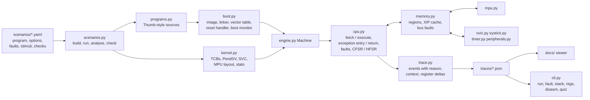

# How the simulator works

This page explains what `r2s` models, how the pieces fit together, and
where the model deliberately simplifies. Read it next to the source: each
module's docstring states the hardware rule it implements.

> **Scope.** A behavioral model for learning and demonstration. It executes
> a subset of Thumb-2 at the assembly level on top of a memory map,
> exception model, NVIC, SysTick, timer and MPU shaped like a Raspberry Pi
> Pico 2 (RP2350, Arm Cortex-M33). It is **not** an RP2350 emulator, it does
> not run binaries, and its cycle costs are approximate, not cycle-accurate.

## Architecture



One clock drives everything: the CPU's cycle counter (the model's DWT
CYCCNT). After each instruction the machine advances SysTick and the 1 MHz
timer by the cycles that instruction cost and fires any button press whose
time has come. `wfi` jumps the clock to the next event, so idle time costs
nothing to simulate.

## The five layers and where they live

| Layer (course weeks) | What the student writes | Model |
|---|---|---|
| 1 ISA (1-2) | Thumb-2 assembly, calling convention | `isa.py` (assembler, instruction table), `cpu.py` (execute, flags), `isa_profiles.py` (costs) |
| 2 Boot (3-4) | linker script, vector table, reset handler | `boot.py` (`link`, `write_image`, `reset_handler_source`, `BootMonitor`) |
| 3 Drivers (3-4) | GPIO, UART, timer via MMIO | `peripherals.py`, `timer.py`, `systick.py`, the register map in `memory.py` |
| 4 Exceptions (5-6) | NVIC setup, SysTick, handlers, fault decoder | `nvic.py`, `cpu.py` (`enter_exception`, `exception_return`, `raise_fault`) |
| 5 Kernel (7-9) | task stacks, PendSV switch, SVC, MPU guards | `kernel.py`, `mpu.py` |
| Experiments (10-11) | flash vs SRAM, ARM vs RISC-V | XIP cache in `memory.py`, profiles in `isa_profiles.py` |

## Layer 1: the instruction subset

`r2s/isa.py` holds the instruction table. Mnemonics and operand forms are
the Thumb-2 ones you read in `objdump -d`: `mov`, `add/adds`, `sub/subs`,
`mul`, `and/orr/eor`, `lsl/lsr`, `cmp`, `ldr/str [rn, #off]`,
`ldr rd, =sym` (literal pool), `push/pop`, `ldmia/stmdb`, `b`, `beq/bne/blt/bge/bgt/ble`,
`bl`, `bx`, `svc`, `cpsid/cpsie`, `mrs/msr`, `wfi`, `nop/dsb/isb`.

Simplifications, all deliberate:

- Every instruction occupies one 4-byte word. On the board Thumb-2 mixes
  2- and 4-byte encodings, so "the instruction before the stacked PC" is
  `PC - 4` here and usually `PC - 2` (for a 16-bit `svc`) on the chip.
- No binary encoding; immediates are not range-checked.
- Flags follow the Arm rules (`C` is *not borrow* for subtraction, `V` is
  signed overflow); only `cmp`, `adds`, `subs` set them.
- `bl` stores `return address | 1` in LR and `bx` / `pop {pc}` honour bit 0
  (the Thumb bit) exactly as on the core.
- A few **pseudo-ops** are clearly not Thumb-2: `mark` (a trace probe),
  `kcall` (calls Python that stands in for C code such as the scheduler),
  `gpio_set/gpio_clr`, `uart_putc/uart_puts` (one store each).

`r2s disasm <program|ID>` prints an annotated listing with the cost of each
instruction, the vector table and the symbol map.

## Layer 2: memory map, image and boot

| Region | Address range | Attributes in the model |
|---|---|---|
| FLASH (XIP) | `0x10000000`-`0x103FFFFF` | read + execute, writes fault; fetches go through a small direct-mapped cache (hit 0, miss +20 cycles) |
| SRAM | `0x20000000`-`0x20081FFF` (520 KB) | read/write/execute |
| PERIPH | `0x40000000`-`0x4FFFFFFF` | GPIO, UART, TIMER registers (+2 cycles per access) |
| PPB | `0xE0000000`-`0xE00FFFFF` | SysTick, NVIC, SCB, MPU, DWT at their architectural addresses; privileged only |

The PPB addresses are the real ARMv8-M ones (`SCB->CFSR` at `0xE000ED28`,
`DWT->CYCCNT` at `0xE0001004`...). The peripheral offsets are simplified:
on the real RP2350 GPIO output goes through SIO and the interrupt status
through IO_BANK0. The IRQ numbers are the RP2350 ones: TIMER0_IRQ_0 = 0,
IO_IRQ_BANK0 = 21.

`boot.link()` is a tiny linker script in Python:

```
FLASH 0x10000000  vector table: word 0 = initial MSP, word 1.. = handler | 1
      0x10000100  .text (startup, main, handlers ...)
      ...         .data load image (initial values)
SRAM  0x20000000  .data, then .bss
      (32-byte aligned) kernel objects: guard + stack per task
      0x20082000  __stack_top: initial MSP (grows down)
```

Power-on (`Machine.power_on`) does only what the hardware does: SRAM is
left with seeded pseudo-random contents, the core reads word 0 of the
vector table into MSP and word 1 into PC, bit 0 of word 1 into xPSR.T, and
starts fetching. Everything after that is code: the reset handler copies
`.data` from `__data_load` (flash) to `__data_start` (SRAM), zeroes `.bss`,
and calls `main`. The **boot monitor** emits six `boot_step` events and
checks each one against the image:

1. `power_on` 2. `vector_table` (SP in SRAM and 8-byte aligned, reset vector points at code, Thumb bit set)
3. `reset_handler` 4. `data_copied` 5. `bss_zeroed` 6. `main_entered`

On the RP2350 the boot ROM runs first and needs an IMAGE_DEF metadata block
near the start of the image before it will launch it. The model leaves room
for that block but does not model the boot ROM.

## Layer 3: drivers

Drivers are stores and loads to peripheral registers:

- GPIO: `GPIO_OUT_SET/CLR` drive pins (LED on 25, scope marker on 16); a
  button on 14 latches an edge in `GPIO_INTR` (write 1 to clear) and pends
  IRQ 21.
- UART: `UART_DR` transmits instantly; every completed line is a `uart_tx` event.
- TIMER: a free-running microsecond counter `TIMERAWL` that does not depend
  on the core clock, and `ALARM0` raising IRQ 0. Its interrupt is level
  sensitive: if the handler does not clear `INTR`, it fires again.
- SysTick: 24-bit down counter. `SYST_RVR` is the reload; the period is
  `RVR + 1` cycles; reaching 0 with TICKINT pends exception 15.

## Layer 4: exceptions

**Priorities.** Lower number = more urgent. Reset, NMI and HardFault are
fixed at -3, -2, -1. Everything else is configurable, byte-packed (IRQ n is
byte `n % 4` of `NVIC_IPR[n / 4]`; PendSV and SysTick are bytes 2 and 3 of
`SHPR3`), with 4 implemented bits (0x41 reads back 0x40, 0xFF as 0xF0). An
exception pre-empts only if its priority is numerically lower than the
current execution priority; PRIMASK raises that to 0.

**Entry** (`Cpu.enter_exception`): if the active SP is not 8-byte aligned a
pad word is inserted and bit 9 of the stacked xPSR is set; then the frame
`r0, r1, r2, r3, r12, lr, pc, xPSR` is written below the SP (r0 at the
lowest address), LR gets EXC_RETURN, IPSR gets the exception number, PC
gets `vector & ~1` and xPSR.T gets `vector & 1`. Cost: 12 cycles.

```
higher addresses   (pad if SP was not 8-byte aligned)
                   xPSR   <- frame + 28
                   PC     <- frame + 24   return address
                   LR     <- frame + 20
                   r12    <- frame + 16
                   r3..r0 <- frame + 12 .. frame + 0  <- SP after entry
```

| EXC_RETURN | Meaning |
|---|---|
| `0xFFFFFFF1` | return to handler mode, frame on MSP (this handler pre-empted another) |
| `0xFFFFFFF9` | return to thread mode, frame on MSP |
| `0xFFFFFFFD` | return to thread mode, frame on PSP (a task was interrupted) |

These are the classic values. ARMv8-M adds bits for the Security
Extension and the FPU. The values above are valid in the Secure state with
no FP context: the RP2350 implements the Security Extension and bare-metal
code runs Secure. Non-secure code, or an Armv8-M core without the Security
Extension, sees `0xFFFFFFB0` / `0xFFFFFFB8` / `0xFFFFFFBC` instead. The model
does not model the Non-secure state, FP frames or late arrival.

**Return** (`bx lr` or `pop {pc}` with EXC_RETURN): if another exception is
pending that may pre-empt the context underneath, the core **tail-chains**
(6 cycles, no unstack/restack, LR keeps the same EXC_RETURN). Otherwise it
pops the frame (10 cycles) and checks integrity: an invalid EXC_RETURN, or a
stacked IPSR that does not match the mode returned to, is a UsageFault
INVPC (that is how a corrupted task stack shows up in P09).

**Faults** (`Cpu.raise_fault`) set sticky bits in CFSR, HFSR, MMFAR and BFAR
at their real addresses (write 1 to clear):

| Register | Bits the model sets |
|---|---|
| MMFSR (CFSR 7:0) | IACCVIOL, DACCVIOL, MUNSTKERR, MSTKERR, MMARVALID |
| BFSR (CFSR 15:8) | IBUSERR, PRECISERR, UNSTKERR, STKERR, BFARVALID |
| UFSR (CFSR 31:16) | UNDEFINSTR, INVSTATE, INVPC, UNALIGNED |
| HFSR | VECTTBL, FORCED |

An instruction fetch from an execute-never part of the default memory map
(peripherals at `0x4xxxxxxx`-`0x5xxxxxxx`, device and system space from
`0xA0000000` up) is a MemManage IACCVIOL even with the MPU off; IBUSERR is
reserved for fetches from unmapped or erroring memory.

A configurable fault escalates to HardFault (HFSR.FORCED) when its handler is
disabled in SHCSR (the reset state) or when its priority cannot pre-empt
(inside a more urgent handler, PRIMASK set). An `svc` that cannot be taken
immediately also becomes a HardFault. A fault while HardFault is active, or
a stacking error while entering HardFault, is a **lockup**. Unprivileged
`cpsid`/`cpsie`/`msr` are ignored without a fault, as on the core; an
unprivileged access to the PPB is a precise BusFault.

## Layer 5: the kernel

`kernel.py` stands in for the C part of a small kernel; the switch itself
is real (model) assembly in `pendsv_source()`:

```
PendSV_Handler:
    mrs   r0, psp
    stmdb r0!, {r4-r11}      ; software frame on the outgoing task's stack
    kcall "sched:switch"     ; save r0 in the TCB, pick next, r0 = next PSP
    ldmia r0!, {r4-r11}
    msr   psp, r0
    bx    lr                 ; 0xFFFFFFFD: pop the next task's hardware frame
```

- A suspended task's stack holds its software frame (r4-r11) below its
  hardware frame: 16 words, 64 bytes. New tasks get a fabricated frame
  (PC = entry, xPSR = Thumb bit, LR = `task_exit | 1`).
- `main` starts the scheduler with `svc #0`: the SVC handler sets PSP,
  CONTROL = 3 (unprivileged, PSP) and returns with `0xFFFFFFFD`.
- SysTick (priority 0x80) does the tick bookkeeping and pends PendSV
  (lowest priority, 0xF0 after masking), which then tail-chains.
- System calls: `svc #n` with arguments in the **stacked** r0. The handler
  finds the frame from EXC_RETURN bit 2, reads `n` from the `svc`
  instruction at stacked `PC - 4`, and writes the result into the stacked
  r0. Calls: 0 start, 1 yield, 2 sleep, 3 write, 4 exit, 5 lock, 6 unlock.
- MPU (ARMv8-M rules: base/limit, 32-byte granularity, overlap is a fault,
  PRIVDEFENA background for privileged code): flash ro, globals rw,
  peripherals rw, a 32-byte guard below each stack, and one region
  moved at every switch to cover the running task's stack.
  *Documented simplification:* the model's guard is "no access". On real Armv8-M the MPU access-permission field has no "no access" encoding: a guard would be AP = read-only, privileged only, plus XN. That faults any unprivileged access and any write (which is all a stack overflow needs) while privileged reads still succeed. The stack-limit registers PSPLIM/MSPLIM (UsageFault STKOF) are the alternative on the Cortex-M33.
- Faults in a task (EXC_RETURN `0xFFFFFFFD`) kill that task and switch to
  another; faults in the kernel halt.
- Statistics: per-task run time, switches, idle %, stack watermarks
  (stacks are filled with `0xA5A5A5A5`; the deepest overwritten word is the
  peak use), context-switch and tick-handler cost from the trace.

## The cycle cost model

Costs come from the `arm_like` profile (`isa_profiles.py`) unless a scenario
selects `riscv_like`:

| Item | arm_like cycles |
|---|---|
| ALU op, `mov`, `cmp` | 1 |
| `ldr` / `str` | 2 + region latency (SRAM 0, PERIPH 2, PPB 1, FLASH 0 or +20 on an XIP miss) |
| `push`/`pop`/`ldm`/`stm` of n registers | 1 + n |
| taken branch | +1 |
| exception entry / return / tail-chain | 12 / 10 / 6 |
| `kcall` stand-ins | `kernel:tick` 20, `sched:switch` 24, `svc:dispatch` 16, `kernel:fault` 60 |

Instruction fetches from flash also pay the XIP cache cost. These numbers
are illustrative: chosen so the *shape* of results matches the board
(latency floor, tail-chain saving, cache effect, relative switch cost), not
to predict real cycle counts. See [what-to-expect.md](what-to-expect.md).

## Traces

Every run writes `traces/<ID>.json`:

```
scenario   the YAML header (title, notes, checks)
config     seed, clock, profile, limits
image_map  vector table, sections, .data/.bss addresses
events     [{seq, t_cycles, t_us, unit, kind, from, to, ctx, reason, regs, details}]
summary    final state, faults (decoded), kernel stats, measurements
result     {passed, checks: [{name, passed, detail}]}
```

`regs` in each event holds only the registers that changed since the
previous event; replaying them gives the full register file at any event.
Runs are deterministic: everything random (power-on SRAM contents) comes
from `random.Random(seed)`, so the same seed gives byte-identical traces.
